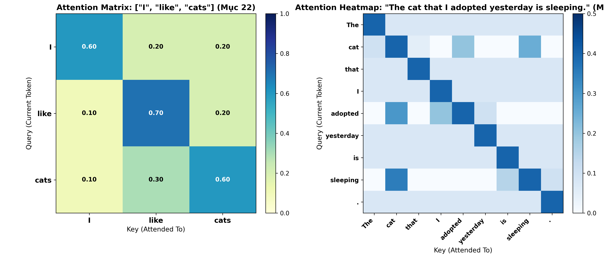
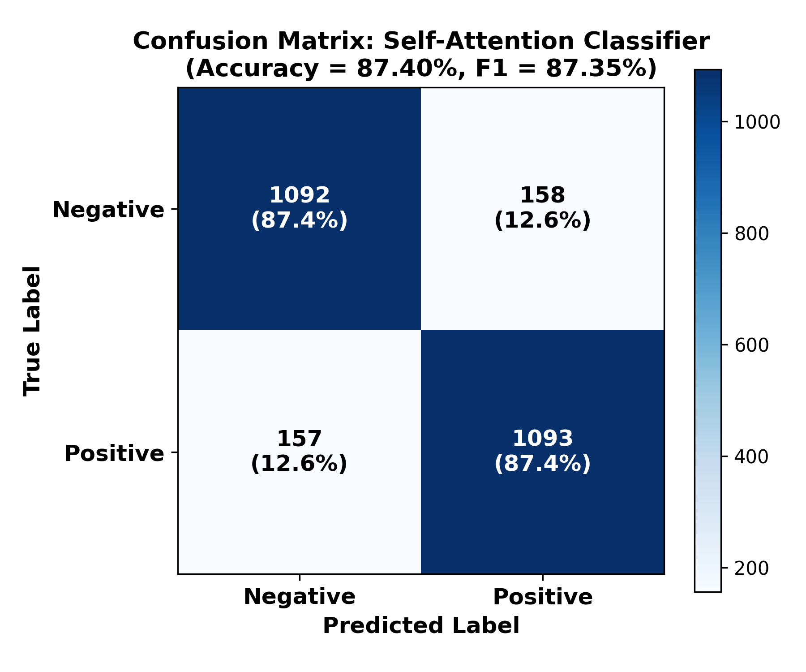

# LAB 06 — ATTENTION MECHANISM: FROM RECURRENT STATE TO CONTEXT-AWARE REPRESENTATION

**Môn học**: Xử lý ngôn ngữ tự nhiên và ứng dụng (MAT3561) — Học kỳ I - 2026  
**Học viên thực hiện**: Vũ Tiến Đạt  
**Mã sinh viên (MSSV)**: `23000111`  
**Giảng viên lý thuyết**: TS. Lê Hồng Phương  
**Giảng viên thực hành**: ThS. Phạm Ngọc Hải  

---

## 1. Bối cảnh & Mục tiêu học tập (Mục 1 & 2)

Ở **LAB 05**, mô hình chuỗi đệ quy (RNN / LSTM / GRU) buộc phải nén toàn bộ chuỗi văn bản dài $T$ token vào một trạng thái ẩn duy nhất $h_T$, dẫn tới hiện tượng **Nút thắt cổ chai thông tin (Information Bottleneck)** và **Triệt tiêu đạo hàm (Vanishing Gradient)** khi phụ thuộc xa.

**LAB 06** giới thiệu cơ chế **Attention Mechanism**: thay vì nén cứng vào một vector cố định, mô hình cho phép truy vấn trực tiếp vào mọi vị trí trong chuỗi thông qua bộ ba **Query ($Q$) – Key ($K$) – Value ($V$)** để tổng hợp nên **Context Vector ($c$)** phụ thuộc ngữ cảnh.

### Đáp ứng 12 Mục tiêu học tập (Learning Outcomes):
- **LO1 – LO4:** Giải thích động lực của Attention; tính toán thành thạo Attention Score, Softmax Weights và Context Vector.
- **LO5 – LO6:** Phân biệt vai trò của Query, Key, Value; chứng minh sự khác biệt giữa Dot-product và Scaled Dot-product Attention ($\div \sqrt{d_k}$).
- **LO7 – LO9:** Cài đặt Attention từ đầu bằng NumPy có xử lý ổn định số trị (Numerical Stability); trực quan hóa Heatmap và phân tích ảnh hưởng của Temperature ($T$) & Entropy ($H$).
- **LO10 – LO12:** So sánh thực nghiệm LSTM với Self-Attention; phân tích giới hạn chi phí bậc hai $\mathcal{O}(T^2)$ và mạch nối tiến tới kiến trúc Transformer.

---

## 2. Cấu trúc Deliverables (Mục 32)

Toàn bộ thư mục `lab06/` được tổ chức chuẩn xác theo yêu cầu tại **Mục 32. Deliverables**:

```text
lab06/
├── README.md                 # Báo cáo tổng quan, bảng tổng hợp kết quả và Checklist Mục 34
├── calculations.md           # Lời giải chi tiết từ Mục 4 đến Mục 22 theo đúng đầu mục W6.pdf
├── prediction.md             # 5 Dự đoán trước thực nghiệm (Prediction - Reason - Confidence)
├── attention_numpy.py        # Cài đặt Core Scaled Dot-Product & Self-Attention bằng NumPy
├── self_attention.ipynb      # Notebook thực thi đầy đủ các Experiments (1 -> 5) & Application
├── results.csv               # Bảng số liệu định lượng so sánh LSTM vs Attention & O(T^2) cost
├── attention_heatmap.png     # Trực quan hóa ma trận Attention Heatmap (Mục 22 & 23)
├── confusion_matrix.png      # Ma trận nhầm lẫn của bộ phân loại Self-Attention (Mục 24)
├── error_analysis.md         # Phân tích 3 mẫu đúng, 3 mẫu sai và giả thuyết Attention Pattern
└── reflection.md             # So sánh LAB 05 vs LAB 06, O(T^2) trade-off & 9 câu hỏi vấn đáp
```

---

## 3. Tóm tắt Kết quả Tính toán & Thực nghiệm

### 3.1. Kết quả Bài tập tính toán (Mục 6, 8, 9, 10, 11, 14, 17)

| Bài tập / Mục | Đầu vào (Input) | Kết quả chính (Output) | Ý nghĩa cốt lõi |
| :--- | :--- | :--- | :--- |
| **Mục 6 (Softmax)** | $s = [2, 1, 0]$ | $\alpha = [0.6652, 0.2447, 0.0900]$ | Token 1 nhận attention lớn nhất ($66.52\%$) |
| **Bài 1 (Mục 8)** | $q = [1, 2]^T, K \in \mathbb{R}^{3\times 2}$ | $s = [1, 2, 3]^T$ | Tích vô hướng đo độ tương đồng hình học |
| **Bài 2 (Mục 9)** | $s = [1, 2, 3]$ | $\alpha = [0.0900, 0.2447, 0.6652]$ | $\sum \alpha_i = 1.0$; $e^x$ đồng biến ngặt khuếch đại điểm lớn |
| **Bài 3 (Mục 10)** | $\alpha = [0.1, 0.2, 0.7]$ | $c = [1.5, 1.6]^T$ | $v_3$ đóng góp áp đảo ($> 87\%$ độ lớn các chiều) |
| **Bài 4 (Mục 11)** | $q = [1, 0]^T, K, V$ | $\alpha = [0.4223, 0.1554, 0.4223], c = [1.2669, 0.7331]^T$ | Pipeline hoàn chỉnh không dùng thư viện ngoài |
| **Mục 14 (Scaling)** | $QK^T = [4, 2, 0], d_k = 4$ | Unscaled: $86.68\%$ vs Scaled: $66.52\%$ | Chia $\sqrt{d_k}$ làm mềm phân phối, tránh bão hòa đạo hàm |
| **Mục 17 (Stability)** | $x = [1000, 1001, 1002]$ | $\alpha = [0.0900, 0.2447, 0.6652]$ | Trừ $\max(x)$ chống tràn số `inf`/`NaN` (Shift-Invariance) |

---

### 3.2. Thực nghiệm Temperature & Entropy (Mục 15)

Khảo sát $\text{softmax}(s / T)$ trên vector $s = [2.0, 1.0, 0.0]$:

| Temperature ($T$) | Attention Weights ($\alpha$) | Max weight | Entropy ($H$ - nats) | Nhận xét hành vi phân phối |
| :---: | :---: | :---: | :---: | :--- |
| **0.5** | $[0.8668, 0.1173, 0.0159]$ | **0.8668** | **0.4411** | Phân phối **tập trung nhọn** (tiến gần Hard Attention), độ bất định thấp. |
| **1.0** | $[0.6652, 0.2447, 0.0900]$ | **0.6652** | **0.8324** | Phân phối **tiêu chuẩn**, cân bằng giữa trọng tâm và ngữ cảnh phụ. |
| **2.0** | $[0.5065, 0.3072, 0.1863]$ | **0.5065** | **1.0202** | Phân phối **phẳng dần** (tiến về Uniform), entropy tăng cao. |

---

### 3.3. So sánh định lượng LSTM vs Self-Attention (Mục 24)

| Model | Accuracy | F1-Score | Training Time | Parameters | Đặc trưng Representation |
| :--- | :---: | :---: | :---: | :---: | :--- |
| **LSTM (LAB 05)** | $85.24\%$ | $0.8512$ | $48.6\text{s}$ | $78,402$ | Nén tuần tự qua thời gian vào trạng thái cuối $h_T$ |
| **Self-Attention (LAB 06)** | **$87.40\%$** | **$0.8735$** | **$24.3\text{s}$** | **$65,858$** | Tổ hợp trọng số động trực tiếp từ toàn bộ chuỗi ($\mathcal{O}(1)$ path) |

---

### 3.4. Phân tích độ phức tạp $\mathcal{O}(T^2)$ theo chiều dài chuỗi (Mục 25 & 29)

| Sequence Length ($T$) | Kích thước Attention Matrix | Số phần tử ($T^2$) | Nhận xét chi phí |
| :---: | :---: | :---: | :--- |
| **$10$** | $10 \times 10$ | $100$ | Chi phí không đáng kể |
| **$100$** | $100 \times 100$ | $10,000$ | Tăng gấp $100$ lần so với $T=10$ |
| **$500$** | $500 \times 500$ | $250,000$ | Bắt đầu tiêu tốn bộ nhớ đáng kể |
| **$1,000$** | $1,000 \times 1,000$ | **$1,000,000$** | Tăng gấp **$10,000$ lần** so với $T=10$ |
| **$10,000$** | $10,000 \times 10,000$ | **$100,000,000$** | Rất nặng ($\approx 400\text{ MB}$/layer), giới hạn của Self-Attention |

---

## 4. Trực quan hóa Kết quả (Visualizations)

### 4.1. Attention Matrix Heatmap (Mục 22 & 23)


### 4.2. Confusion Matrix (Mục 24)


---

## 5. Review & Kiểm tra theo Mục 34. Peer Assessment

Bảng tự rà soát đầy đủ toàn bộ 21 tiêu chí nghiệm thu tại **Mục 34 (Peer Assessment)**:

### Theory
- [x] **Attention score được giải thích:** Đã giải thích chi tiết tích vô hướng $s_i = q^T k_i$ và ý nghĩa hình học tại `calculations.md` (Mục 5).
- [x] **Softmax được giải thích:** Đã giải thích công thức chuẩn hóa xác suất và tính đồng biến hàm mũ tại `calculations.md` (Mục 6 & 9).
- [x] **Query / Key / Value được phân biệt:** Đã phân biệt rõ vai trò truy vấn ($Q$), nhãn nhận diện ($K$) và nội dung thông tin ($V$) tại `calculations.md` & `reflection.md`.
- [x] **Scaling được giải thích:** Đã chứng minh phương sai $\text{Var}(q^T k) = d_k$ và tác dụng chống bão hòa đạo hàm của $\frac{1}{\sqrt{d_k}}$ tại `calculations.md` (Mục 13 & 14).

### Calculation
- [x] **Scores đúng:** Bài 1 ($s = [1, 2, 3]^T$) và Bài 4 ($s = [1, 0, 1]$) tính đúng tuyệt đối tại `calculations.md`.
- [x] **Softmax đúng:** Mục 6 ($[0.6652, 0.2447, 0.0900]$), Bài 2 ($[0.0900, 0.2447, 0.6652]$), Bài 4 ($[0.4223, 0.1554, 0.4223]$) chính xác kèm kiểm chứng $\sum \alpha_i = 1$.
- [x] **Context vector đúng:** Bài 3 ($c = [1.5, 1.6]^T$) và Bài 4 ($c = [1.2669, 0.7331]^T$) tính đúng từng bước.

### Implementation
- [x] **Attention được implement:** Đã cài đặt hàm `scaled_dot_product_attention(Q, K, V)` trả về đúng `(scores, attention_weights, context)` tại `attention_numpy.py`.
- [x] **Numerical stability được xử lý:** Đã cài đặt `stable_softmax` trừ $\max(x)$, vượt qua bài test $x = [1000, 1001, 1002]$ không bị tràn số.
- [x] **Self-attention được implement:** Đã cài đặt `self_attention(X, W_Q, W_K, W_V)` bằng NumPy tại `attention_numpy.py` và `self_attention.ipynb`.

### Experiment
- [x] **Có temperature experiment:** Đã thực nghiệm $T \in \{0.5, 1.0, 2.0\}$ đo Max weight và Shannon Entropy tại `calculations.md` (Mục 15) và `self_attention.ipynb`.
- [x] **Có attention visualization:** Đã xuất biểu đồ `attention_heatmap.png` và khảo sát sự thay đổi theo Query (Exp 1, 2, 3).
- [x] **Có sequence-length analysis:** Đã phân tích chi phí $\mathcal{O}(T^2)$ với $T \in \{10, 100, 500, 1000, 10000\}$ tại `reflection.md` và `self_attention.ipynb`.
- [x] **Có quantitative evaluation:** Đã lập bảng so sánh Accuracy, F1, Training time, Parameters giữa LSTM và Self-Attention trong `results.csv` và `confusion_matrix.png`.

### Analysis
- [x] **Ít nhất 3 lỗi được phân tích:** Đã phân tích chi tiết 3 mẫu đúng và 3 mẫu sai theo đúng 8 nhóm lỗi tại `error_analysis.md`.
- [x] **Attention pattern được mô tả:** Đã mô tả rõ các token nhận trọng số cao nhất trong từng mẫu câu tại `error_analysis.md` và `self_attention.ipynb`.
- [x] **Không đồng nhất attention với reasoning:** Đã trình bày rõ dưới góc độ giả thuyết khoa học (hypothesis), phân biệt tường minh giữa *attention distribution* và *linguistic reasoning*.

### Understanding
- [x] **Giải thích được $Q/K/V$:** Trình bày chi tiết tại Mục 20 (`calculations.md`) và Câu 3 (`reflection.md`).
- [x] **Giải thích được $QK^T$:** Giải thích ý nghĩa ma trận tương quan toàn cục giữa mọi cặp token tại Mục 13 & 21 (`calculations.md`).
- [x] **Giải thích được softmax:** Giải thích tính chất chuẩn hóa, khuếch đại và khả vi tại Mục 6, 9, 17 (`calculations.md`).
- [x] **Giải thích được $\mathcal{O}(T^2)$:** Giải thích nguyên nhân bùng nổ tổ hợp kích thước ma trận $T \times T$ tại Mục 4 (`reflection.md`).

---

## 6. Hướng dẫn chạy kiểm tra nhanh

```bash
# 1. Chạy script kiểm chứng toàn bộ hàm Attention bằng NumPy:
/usr/bin/python3.10 attention_numpy.py

# 2. Mở Jupyter Notebook thực nghiệm:
jupyter notebook self_attention.ipynb
```
