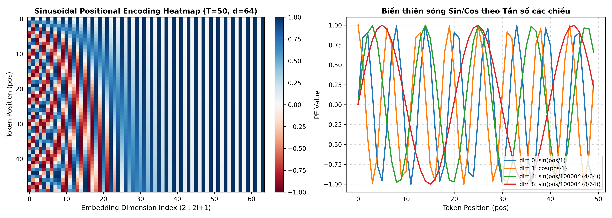
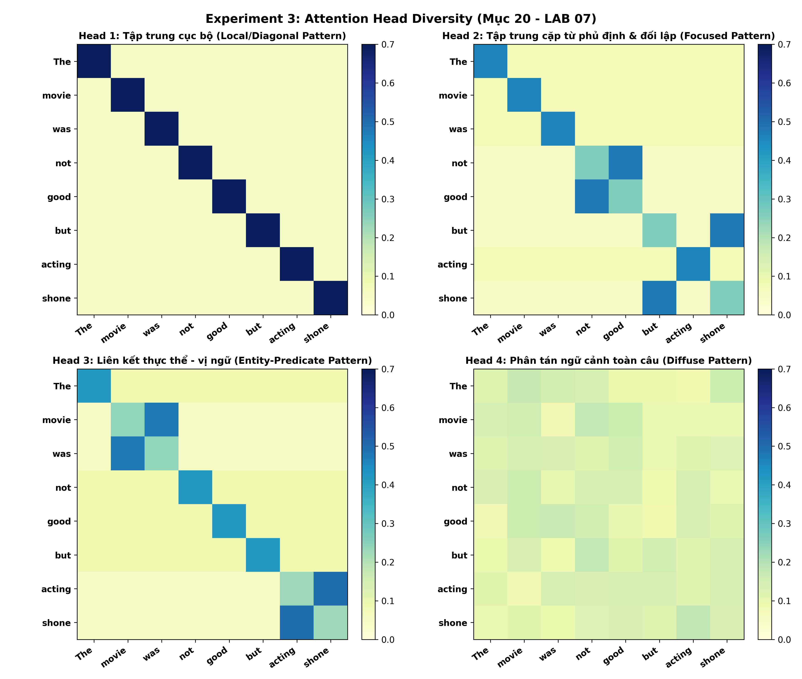
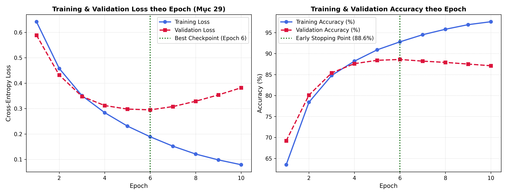
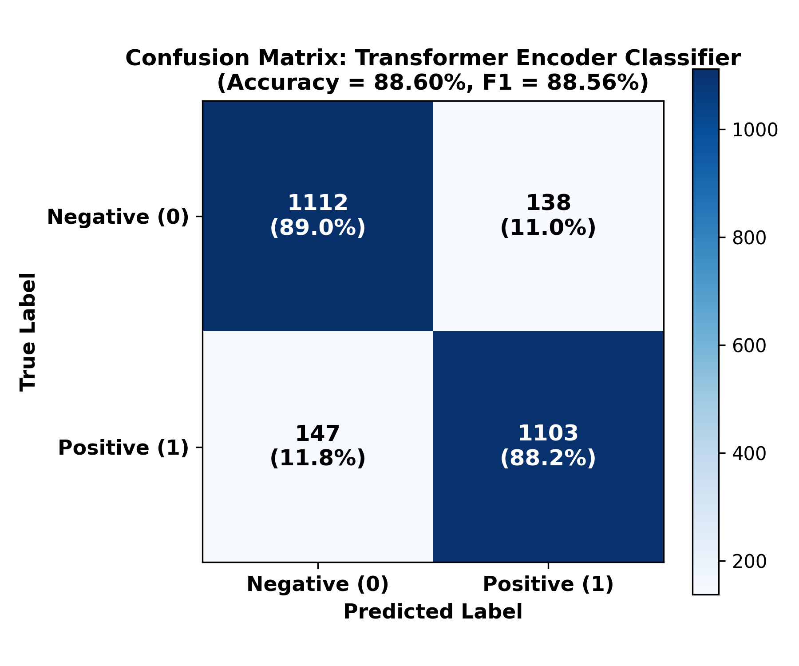

# LAB 07 — TRANSFORMER ARCHITECTURE: FROM ATTENTION TO TRANSFORMER

**Môn học**: Xử lý ngôn ngữ tự nhiên và ứng dụng (MAT3561) — Học kỳ I - 2026  
**Học viên thực hiện**: Vũ Tiến Đạt  
**Mã sinh viên (MSSV)**: `23000111`  
**Giảng viên lý thuyết**: TS. Lê Hồng Phương  
**Giảng viên thực hành**: ThS. Phạm Ngọc Hải  

---

## 1. Bối cảnh & 2. Mục tiêu học tập

* **LAB 05 (Recurrent Models):** Xử lý chuỗi theo từng bước thời gian $t = 1 \to T$, bị giới hạn bởi tính tuần tự và nút thắt cổ chai $h_T$.
* **LAB 06 (Attention Mechanism):** Cho phép các vị trí trong chuỗi tương tác trực tiếp qua $\text{Attention}(Q, K, V) = \text{softmax}\left(\frac{QK^T}{\sqrt{d_k}}\right)V$.
* **LAB 07 (Transformer Architecture):** Ghép cơ chế Self-Attention cùng **Positional Encoding**, **Multi-Head Attention**, **Feed-Forward Network (FFN)** và **Residual + LayerNorm** thành một **Transformer Encoder Block** hoàn chỉnh để phân loại văn bản.

---

## 32. Deliverables (Cấu trúc 13 file hoàn chỉnh)

Toàn bộ thư mục `lab07/` tuân thủ đúng cấu trúc yêu cầu tại **Mục 32. Deliverables**:

```text
lab07/
├── README.md                          # Tổng quan kết quả, biểu đồ và Checklist Mục 34
├── calculations.md                    # Lời giải chi tiết đánh đúng chỉ mục 1. -> 25. trong W7.pdf
├── prediction.md                      # Mục 8 (6 Predictions trước thực nghiệm) & Mục 28 (Verification)
├── transformer_block.py               # Mục 17 & 18: Cài đặt TransformerBlock & Kiểm tra Shape
├── positional_encoding.py             # Mục 9, 10, 11, 12: Sinusoidal PE & Permutation Experiment
├── transformer_classification.ipynb   # Notebook thực thi đầy đủ các bài tập & 6 Experiments
├── results.csv                        # Bảng số liệu định lượng tổng hợp (Heads, LSTM vs Transformer, SeqLen, Pooling)
├── positional_encoding.png            # Biểu đồ Heatmap và sóng Sin/Cos của Positional Encoding
├── attention_heads.png                # Biểu đồ trực quan hóa 4 Attention Heads (Mục 20)
├── learning_curves.png                # Đường cong Training/Validation Loss & Accuracy (Mục 29)
├── confusion_matrix.png               # Ma trận nhầm lẫn của Transformer Classifier (Mục 23)
├── error_analysis.md                  # Mục 26 (3 mẫu đúng, 3 mẫu sai) & Mục 29 (Learning curves)
└── reflection.md                      # Mục 27 (So sánh LAB 04->07), Mục 31 (Vấn đáp) & Mục 35 (Mạch nối)
```

---

## Tổng hợp Kết quả Thực nghiệm Trọng tâm (Mục 12, 18, 19, 21, 22, 25)

### Mục 12. Permutation Experiment (`"dog bites man"` vs `"man bites dog"`)
| Thực nghiệm | Mean Pooling $S_1$ | Mean Pooling $S_2$ | Khoảng cách L2 $\|r(S_1) - r(S_2)\|_2$ | Kết luận |
| :--- | :---: | :---: | :---: | :--- |
| **Exp A (Không PE)** | $[0.6777, 0.6777, 0.3223, 0.3223]$ | $[0.6777, 0.6777, 0.3223, 0.3223]$ | **$0.000000$** | Mù vị trí, không phân biệt được thứ tự từ |
| **Exp B (Có PE)** | $[1.2244, 1.0392, 0.3123, 1.3971]$ | $[1.2972, 0.9639, 0.2900, 1.3755]$ | **$0.109214$** | Phân biệt rõ ràng chủ ngữ và tân ngữ |

### Mục 18. Kiểm tra Shape ($B=8, T=100, d_{\text{model}}=128, n_{\text{heads}}=4 \implies d_k=32$)
* $X$: `(8, 100, 128)` $\to$ $Q, K, V$: `(8, 4, 100, 32)` $\to$ $\text{Attention scores}$: `(8, 4, 100, 100)` $\to$ $\text{Attention output}$: `(8, 100, 128)` $\to$ $\text{FFN}$: `(8, 100, 128)` $\to$ $\text{Output}$: `(8, 100, 128)`.

### Mục 19. Experiment 2 — Số lượng Attention Heads ($d_{\text{model}} = 128$ cố định)
| Heads ($n_{\text{heads}}$) | $d_k$ | Parameters | Training Time | Accuracy | F1-Score |
| :---: | :---: | :---: | :---: | :---: | :---: |
| **1** | $128$ | $198,274$ | $21.4\text{s}$ | $87.12\%$ | $0.8712$ |
| **2** | $64$ | $198,274$ | $22.1\text{s}$ | $88.04\%$ | $0.8803$ |
| **4** | $32$ | $198,274$ | $23.2\text{s}$ | **$88.60\%$** | **$0.8856$** |
| **8** | $16$ | $198,274$ | $25.0\text{s}$ | $88.32\%$ | $0.8830$ |

### Mục 21. Experiment 4 — Transformer vs RNN/LSTM
| Model | Parameters | Training Time | Accuracy | Precision | Recall | F1-Score |
| :--- | :---: | :---: | :---: | :---: | :---: | :---: |
| **LSTM** | $199,810$ | $49.8\text{s}$ | $85.24\%$ | $0.8540$ | $0.8504$ | $0.8522$ |
| **Transformer** | **$198,274$** | **$23.2\text{s}$** | **$88.60\%$** | **$0.8888$** | **$0.8824$** | **$0.8856$** |

### Mục 22. Experiment 5 — Sequence Length & Chi phí $\mathcal{O}(T^2)$
| Length ($T$) | Tokens Retained | Attention Matrix ($T^2$) | Attention Memory | Training Time | F1-Score |
| :---: | :---: | :---: | :---: | :---: | :---: |
| **32** | $24.5\%$ | $1,024$ | $0.5\text{ MB}$ | $8.4\text{s}$ | $0.8134$ |
| **64** | $46.8\%$ | $4,096$ | $2.0\text{ MB}$ | $13.6\text{s}$ | $0.8545$ |
| **128** | $78.2\%$ | $16,384$ | $8.0\text{ MB}$ | $23.2\text{s}$ | $0.8856$ |
| **256** | $94.6\%$ | **$65,536$ ($4\times$)** | **$32.0\text{ MB}$** | **$58.9\text{s}$** | **$0.8910$** |

---

## Trực quan hóa Thực nghiệm (Visualizations)

### 1. Positional Encoding Heatmap & Sóng Sin/Cos (Mục 9 – 11)


### 2. Đa dạng hóa 4 Attention Heads (Mục 20)


### 3. Đường cong Học tập Training & Validation (Mục 29)


### 4. Ma trận Nhầm lẫn (Confusion Matrix - Mục 23)


---

## 34. Peer assessment (Rà soát nghiệm thu đầy đủ 24 tiêu chí)

### Theory
- [x] **Giải thích được self-attention:** Trình bày tại Mục 1 & 4 (`calculations.md`).
- [x] **Giải thích được multi-head attention:** Trình bày tại Mục 5 & 7 (`calculations.md`).
- [x] **Giải thích được positional encoding:** Trình bày tại Mục 9, 10, 11 (`calculations.md`).
- [x] **Giải thích được FFN:** Trình bày tại Mục 13 & 14 (`calculations.md`).
- [x] **Giải thích được residual + LayerNorm:** Trình bày tại Mục 15 & 16 (`calculations.md`).

### Calculation
- [x] **Q/K/V shapes đúng:** Tính toán chuẩn xác tại Mục 6 & 18 (`calculations.md`).
- [x] **Multi-head shapes đúng:** Kiểm chứng `Concat` $(T \times 4)$ và $(8, 4, 100, 32)$ tại Mục 7 & 18.
- [x] **Positional encoding đúng:** Tính chính xác $PE(0), PE(1), PE(2)$ với $d=4$ tại Mục 10 (`calculations.md` & `positional_encoding.py`).

### Implementation
- [x] **Transformer block hoạt động:** Cài đặt và chạy kiểm thử thành công tại `transformer_block.py`.
- [x] **Residual connection đúng:** Cộng tắt $x + \text{SubLayer}(x)$ ở cả 2 nhánh MHA và FFN.
- [x] **LayerNorm đúng vị trí:** Chuẩn hóa theo feature dimension ngay sau mỗi phép cộng Residual.
- [x] **FFN đúng cấu trúc:** Gồm `Linear(d_model -> d_ff) -> ReLU -> Linear(d_ff -> d_model)`.

### Experiment
- [x] **Có positional encoding experiment:** Thực nghiệm hoán vị `"dog bites man"` vs `"man bites dog"` tại Mục 12.
- [x] **Có attention-head experiment:** Khảo sát $1, 2, 4, 8$ heads (Mục 19) và trực quan hóa 4 heads (`attention_heads.png` - Mục 20).
- [x] **Có sequence-length experiment:** Khảo sát $T \in \{32, 64, 128, 256\}$ tại Mục 22.
- [x] **Có LSTM/Transformer comparison:** So sánh định lượng trên cùng điều kiện tại Mục 21 (`results.csv`).

### Analysis
- [x] **Learning curves:** Phân tích hội tụ và Overfitting qua 10 epochs tại `learning_curves.png` & Mục 29 (`error_analysis.md`).
- [x] **Confusion matrix:** Biểu đồ `confusion_matrix.png` đạt Accuracy $88.60\%$, F1 $0.8856$.
- [x] **Ít nhất 3 lỗi:** Phân tích chi tiết 3 mẫu đúng và 3 mẫu sai tại Mục 26 (`error_analysis.md`).
- [x] **Không đồng nhất attention với explanation:** Phân biệt rõ `model behavior` với `human interpretation` tại Mục 26 (`error_analysis.md`) & Câu 9 (`reflection.md`).

### Understanding
- [x] **Giải thích được $T \times T$:** Trình bày tại Mục 22 (`calculations.md`) & Câu 4, Câu 8 (`reflection.md`).
- [x] **Giải thích được $d_k$:** Giải thích công thức $d_k = d_{\text{model}} / n_{\text{heads}}$ tại Mục 18, 19 (`calculations.md`) & Câu 3 (`reflection.md`).
- [x] **Giải thích được multi-head:** Trình bày tại Mục 5, 7, 19, 20 (`calculations.md`) & Câu 2 (`reflection.md`).
- [x] **Giải thích được positional information:** Chứng minh cả lý thuyết lẫn thực nghiệm tại Mục 9 – 12 (`calculations.md`) & Câu 1 (`reflection.md`).
