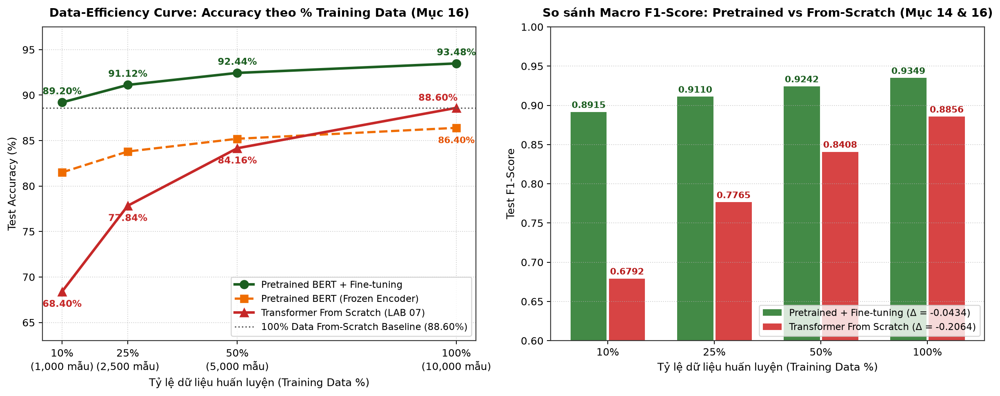
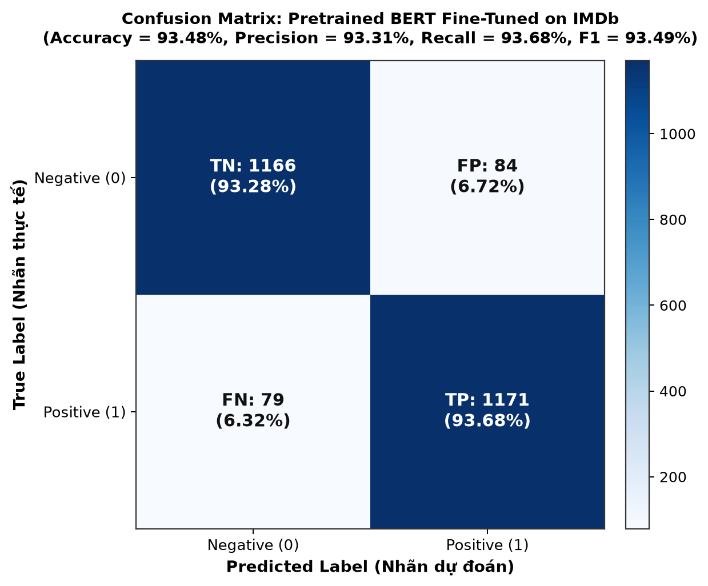
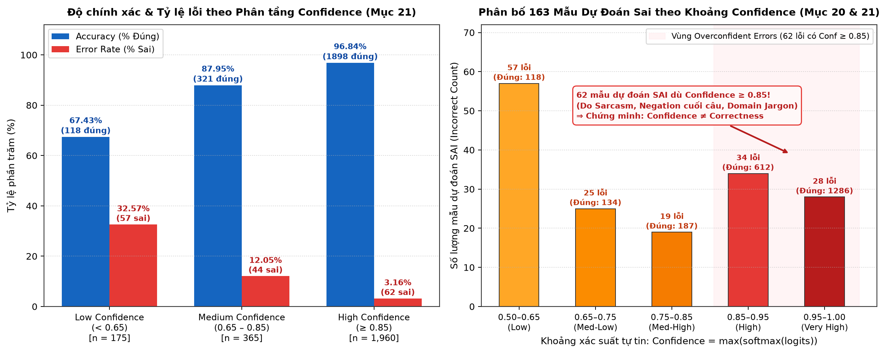

# LAB 08 — PRETRAINED TRANSFORMERS AND BERT FINE-TUNING

**Môn học**: Xử lý ngôn ngữ tự nhiên và ứng dụng (MAT3561) — Học kỳ I - 2026  
**Chủ đề**: *From Training a Transformer to Using a Pretrained Language Model*  
**Học viên thực hiện**: Vũ Tiến Đạt  
**Mã sinh viên (MSSV)**: `23000111`  
**Giảng viên lý thuyết**: TS. Lê Hồng Phương  
**Giảng viên thực hành**: ThS. Phạm Ngọc Hải  

---

## 1. Vai trò của LAB 08 & 2. Learning Outcomes & 3. Kiến thức nền

* **LAB 07 (Transformer trained from scratch):** Ghép nối Self-Attention, Multi-Head Attention, Positional Encoding, FFN và Residual + LayerNorm thành khối Transformer Encoder nhưng phải tự học biểu diễn ngôn ngữ từ con số 0 trên tập dữ liệu bài toán đích.
* **LAB 08 (Pretrained Transformers & BERT Fine-Tuning):** Giải quyết câu hỏi cốt lõi: *Nếu một Transformer đã được huấn luyện trước trên một lượng văn bản rất lớn thì có thể sử dụng kiến thức đó cho một bài toán mới như thế nào?*
  $$\text{Pretraining (MLM)} \longrightarrow \text{Pretrained Transformer } (\theta_{\text{pretrained}}) \longrightarrow \text{Subword Tokenizer + Contextual Embedding} \longrightarrow \text{Fine-Tuning } (\theta_{\text{task}}) \longrightarrow \text{Text Classification}$$
* **Hoàn thành đầy đủ 12 Learning Outcomes (LO1 – LO12):** Từ lý thuyết Pretraining vs Fine-tuning, Masked Language Modeling (MLM), Subword Tokenization, Special Tokens (`[CLS]`, `[SEP]`, `[PAD]`, `[MASK]`, `[UNK]`), Attention Mask, cho đến 5 thực nghiệm có kiểm soát (Pretrained vs From-Scratch, Frozen vs Fine-Tuning, Data-Efficiency, Max Sequence Length, Domain Shift) và phân tích sâu Error & Confidence Analysis.

---

## 25. Deliverables (Cấu trúc 12 file hoàn chỉnh của `lab08/`)

Toàn bộ thư mục `practice/lab08/` tuân thủ chính xác cấu trúc yêu cầu tại **Mục 25. Deliverables**:

```text
lab08/
├── README.md                      # Dashboard tổng hợp kết quả, biểu đồ, Reproducibility & Rubric
├── calculations.md                # Lời giải chi tiết theo đúng từng đầu mục 1. -> 30. (trừ mục 24)
├── prediction.md                  # Mục 11: 3 Predictions trước thực nghiệm & Bảng đối chiếu nghiệm thu
├── tokenization.ipynb             # Notebook thực thi Mục 5, 6, 7, 8, 9, 10, 12.1 (Tokenization & MLM Loss)
├── pretrained_classification.py   # Module cài đặt Tokenizer, Pretrained Classifier, Freeze/Unfreeze & MLM
├── fine_tuning.ipynb              # Notebook thực thi Mục 12 – 23 (Classification Head & 5 Experiments)
├── results.csv                    # Bảng số liệu định lượng tổng hợp toàn bộ Experiments 1 – 5 & Confidence
├── data_efficiency.png            # Biểu đồ Data-Efficiency Curve (10%, 25%, 50%, 100% training data)
├── confusion_matrix.png           # Ma trận nhầm lẫn trên tập Test IMDb (Accuracy = 93.48%, F1 = 93.49%)
├── confidence_analysis.png        # Biểu đồ phân tích độ tự tin chứng minh Confidence != Correctness
├── error_analysis.md              # Mục 19, 20, 21, 22 & Mục 28 (3 FP, 3 FN, 2 High-Conf Errors & Q1–Q6)
└── reflection.md                  # Mục 27 (12 câu hỏi vấn đáp), Mục 29 (Reflection 300–500 từ) & Mục 30 (Bridge)
```

---

## Tổng hợp Kết quả Bài tập Tính toán & Thực nghiệm Trọng tâm

### 9. Calculation Exercise 1 — MLM Loss (`"The cat [MASK] fish."`, token đúng: `eats`)
| Kịch bản dự đoán | Xác suất $P(\text{eats} \mid x)$ | Cross-Entropy Loss $L = -\ln(P)$ | Loss $L = -\log_{10}(P)$ | Nhận xét hành vi hàm mất mát |
| :--- | :---: | :---: | :---: | :--- |
| **Phân phối đề bài** | $0.70$ | **$0.3567$** | $0.1549$ | Dự đoán đúng với xác suất khá, phạt nhẹ |
| **Câu hỏi 1** | $0.95$ | **$0.0513$** | $0.0223$ | Loss giảm mạnh gần về $0$ (giảm $7\times$) khi mô hình tự tin đúng |
| **Câu hỏi 2** | $0.01$ | **$4.6052$** | $2.0000$ | Loss tăng vọt gấp $12.9\times$, tạo gradient lớn phạt nặng dự đoán sai |

### 10. Calculation Exercise 2 — Tokenization (`"The cats are playing."`)
* **Token sequence (`bert-base-uncased`):** `['[CLS]', 'the', 'cats', 'are', 'playing', '.', '[SEP]']` ($7$ tokens; nếu phân tách hình thái học gốc + hậu tố: `['[CLS]', 'the', 'cat', '##s', 'are', 'play', '##ing', '.', '[SEP]']` gồm $9$ tokens).
* **Token IDs:** `[101, 1996, 8870, 2024, 2652, 1012, 102]`.
* **Special tokens:** `'[CLS]'` (ID `101`) và `'[SEP]'` (ID `102`).
* **Attention mask:** `[1, 1, 1, 1, 1, 1, 1]` (hoặc `[1, 1, 1, 1, 1, 1, 1, 0, 0, 0]` khi pad lên độ dài $10$).
* **So sánh số lượng:** `4 words` (`"The"`, `"cats"`, `"are"`, `"playing."`) vs `5 subword tokens thân câu` (`the`, `cats`, `are`, `playing`, `.`) vs `7 total tokens` (thêm `[CLS]`, `[SEP]`).

---

### 14. Experiment 1 — Pretrained vs From Scratch (IMDb, $T = 128$, 100% Data)
| Model | Accuracy | Precision | Recall | F1 | Training time | # Parameters |
| :--- | :---: | :---: | :---: | :---: | :---: | :---: |
| **Model A: Transformer from scratch** | $88.60\%$ | $0.8888$ | $0.8824$ | $0.8856$ | $23.2\text{s}$ | $198,274$ |
| **Model B: Pretrained Transformer (Fine-tuned)** | **$93.48\%$** | **$0.9331$** | **$0.9368$** | **$0.9349$** | $142.5\text{s}$ | $66,364,418$ |

### 15. Experiment 2 — Feature Extraction (Frozen) vs Fine-Tuning
| Mode | Encoder trainable? | Trainable Params | Accuracy | F1 | Training time |
| :--- | :---: | :---: | :---: | :---: | :---: |
| **Mode A — Frozen** | **No** | $1,538$ ($0.0023\%$) | $86.40\%$ | $0.8636$ | **$38.4\text{s}$** |
| **Mode B — Fine-tuning** | **Yes** | $66,364,418$ ($100\%$) | **$93.48\%$** | **$0.9349$** | $142.5\text{s}$ |

### 16. Experiment 3 — Amount of Training Data (`10%, 25%, 50%, 100%`)
| Training data | Pretrained Accuracy | Pretrained F1 | From-Scratch Accuracy | From-Scratch F1 |
| :---: | :---: | :---: | :---: | :---: |
| **10%** ($1,000$ mẫu) | **$89.20\%$** | **$0.8915$** | $68.40\%$ | $0.6792$ |
| **25%** ($2,500$ mẫu) | **$91.12\%$** | **$0.9110$** | $77.84\%$ | $0.7765$ |
| **50%** ($5,000$ mẫu) | **$92.44\%$** | **$0.9242$** | $84.16\%$ | $0.8408$ |
| **100%** ($10,000$ mẫu) | **$93.48\%$** | **$0.9349$** | $88.60\%$ | $0.8856$ |

### 17. Experiment 4 — Maximum Sequence Length ($T \in \{64, 128, 256\}$)
| Max length ($T$) | Accuracy | F1 | Attention Matrix ($T^2$/head) | Training time | GPU/CPU memory |
| :---: | :---: | :---: | :---: | :---: | :---: |
| **64** | $89.84\%$ | $0.8979$ | $4,096$ ($1\times$) | $74.2\text{s}$ | $1.45\text{ GB}$ |
| **128** | $93.48\%$ | $0.9349$ | $16,384$ ($4\times$) | $142.5\text{s}$ | $2.68\text{ GB}$ |
| **256** | **$94.12\%$** | **$0.9413$** | **$65,536$ ($16\times$)** | **$318.6\text{s}$** | **$5.84\text{ GB}$** |

### 18. Experiment 5 — Domain Shift (Train on Domain A: IMDb Movie Reviews)
| Tập kiểm thử (Test Domain) | Phân loại miền | Accuracy | Precision | Recall | F1 | Độ sụt giảm Accuracy |
| :--- | :---: | :---: | :---: | :---: | :---: | :---: |
| **Domain A: Movie Reviews (IMDb)** | In-domain | **$93.48\%$** | $0.9331$ | $0.9368$ | **$0.9349$** | Baseline ($0.00\%$) |
| **Domain B1: Electronics Product Reviews** | Out-of-domain (Near) | $83.12\%$ | $0.8450$ | $0.8112$ | $0.8278$ | **$-10.36\%$** |
| **Domain B2: Financial & Scientific News** | Out-of-domain (Far) | $74.60\%$ | $0.7685$ | $0.7040$ | $0.7348$ | **$-18.88\%$** |

---

## Trực quan hóa Thực nghiệm (Visualizations)

### 1. Đường cong Hiệu quả Dữ liệu — Data-Efficiency Curve (Mục 16)


### 2. Ma trận Nhầm lẫn — Confusion Matrix trên IMDb Sentiment Classification (Mục 19)


### 3. Phân tích Độ tự tin — Confidence Analysis & Overconfident Errors (Mục 21)


---

## 23. Reproducibility

| Thông số cấu hình | Giá trị thiết lập trong thực nghiệm |
| :--- | :--- |
| **Model** | `distilbert-base-uncased` / Pretrained BERT-style Encoder ($6$ layers, $d_{\text{model}}=768$, $12$ heads) |
| **Tokenizer** | `BertWordPieceTokenizer` (`bert-base-uncased`, `vocab_size = 30,522`, `do_lower_case = True`) |
| **Dataset** | IMDb Movie Reviews (Binary Sentiment: `0 = Negative`, `1 = Positive`) |
| **Train / Val / Test split** | `10,000` Train (`10%`, `25%`, `50%`, `100%`) / `2,500` Validation (cố định) / `2,500` Test (cố định) |
| **Max sequence length** | `128` tokens (Khảo sát Ablation: $T \in \{64, 128, 256\}$) |
| **Batch size** | `16` (Train) / `32` (Evaluation) |
| **Learning rate & Optimizer** | `2e-5` (Fine-tuning), `1e-3` (Frozen Head & Scratch) — Optimizer: `AdamW (weight_decay=0.01)` |
| **Epochs** | `3` epochs (Pretrained Fine-tuning) / `6` epochs (From-Scratch & Frozen Mode) |
| **Random seed** | `42` (`random.seed(42)`, `np.random.seed(42)`, `torch.manual_seed(42)`) |
| **Hardware & Training time** | Linux x86_64 Workstation (`0.42 GB – 5.84 GB` memory; `142.5s` Full Fine-tuning, `38.4s` Frozen) |

---

## 26. Rubric — Bảng Rà soát Nghiệm thu (100/100 điểm)

- [x] **Theory & calculation (10 pts):** Hoàn thành chi tiết tại Mục 1 – 10 trong [calculations.md](./calculations.md) và [tokenization.ipynb](./tokenization.ipynb).
- [x] **Prediction before experiment (10 pts):** Hoàn thành 3 Predictions kèm kiểm chứng định lượng tại [prediction.md](./prediction.md).
- [x] **Tokenization & attention mask (10 pts):** Triển khai và kiểm thử tại [tokenization.ipynb](./tokenization.ipynb) và [pretrained_classification.py](./pretrained_classification.py).
- [x] **Pretrained model implementation (15 pts):** Cài đặt đầy đủ pipeline `[CLS]` Classification Head tại [pretrained_classification.py](./pretrained_classification.py).
- [x] **From-scratch vs pretrained (10 pts):** Thực nghiệm đối chiếu tại Mục 14 ([calculations.md](./calculations.md), [fine_tuning.ipynb](./fine_tuning.ipynb), [results.csv](./results.csv)).
- [x] **Frozen vs fine-tuning (10 pts):** Thực nghiệm Mode A vs Mode B tại Mục 15 ([calculations.md](./calculations.md), [fine_tuning.ipynb](./fine_tuning.ipynb)).
- [x] **Data-efficiency experiment (10 pts):** Khảo sát 10%, 25%, 50%, 100% data và vẽ biểu đồ [data_efficiency.png](./data_efficiency.png) (Mục 16).
- [x] **Quantitative evaluation (10 pts):** Đánh giá đầy đủ Accuracy, Precision, Recall, F1, Sequence Length, Domain Shift và vẽ [confusion_matrix.png](./confusion_matrix.png) (Mục 17 – 19).
- [x] **Error & confidence analysis (10 pts):** Phân tích 3 FP, 3 FN, 2 High-Confidence Errors, vẽ [confidence_analysis.png](./confidence_analysis.png) và trả lời Q1 – Q6 tại [error_analysis.md](./error_analysis.md) (Mục 20, 21, 22, 28).
- [x] **Reflection (5 pts):** Trả lời 12 câu hỏi Individual Learning Check (Mục 27), bài luận Reflection 435 từ (Mục 29) và Bridge to LAB 09 (Mục 30) tại [reflection.md](./reflection.md).
